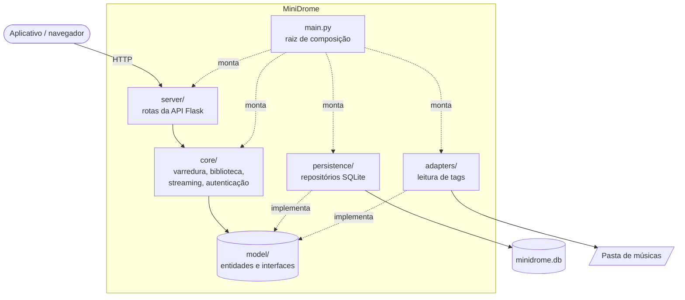

# MiniDrome

Servidor de música simplificado em Python, criado como projeto de arquitetura inicial no
trabalho da disciplina **Arquitetura de Software (ARS)** do Bacharelado em Engenharia de Software (UDESC/CEAVI).

O MiniDrome reproduz, em escala reduzida, as decisões arquiteturais observadas no
[Navidrome](https://github.com/navidrome/navidrome): monólito em camadas, banco SQLite,
repositórios definidos por interfaces, adaptadores nas bordas e testes automatizados desde o início.

**Autora:** Maria Heloisa Witt

## Funcionalidades

- Varredura de uma pasta de músicas e armazenamento dos metadados em SQLite
- Listagem de álbuns e pesquisa de músicas por API REST
- Streaming de músicas, com suporte a requisições parciais (`Range`)
- Autenticação de usuários com senha em hash (PBKDF2) e token assinado (HMAC)

## Arquitetura



| Pacote | Responsabilidade | Equivalente no Navidrome |
| --- | --- | --- |
| `model/` | Entidades (`Musica`, `Album`, `Usuario`) e interfaces (`MusicaRepository`, `LeitorDeTags`) | `model/` |
| `core/` | Regras do sistema: varredura, biblioteca, streaming e autenticação | `core/` e `scanner/` |
| `persistence/` | Implementação dos repositórios em SQLite | `persistence/` |
| `adapters/` | Leitura de metadados com mutagen, com alternativa pela estrutura de pastas | `adapters/` |
| `server/` | Rotas HTTP da API REST (Flask) | `server/` |
| `main.py` | Cria as dependências e conecta as camadas (injeção de dependência manual) | `cmd/` com Google Wire |

### Regras de dependência

- `model` não depende de nenhum outro pacote do projeto;
- `core` depende apenas de `model`;
- `server` chama `core` e nunca acessa `persistence` ou `adapters` diretamente;
- só o `main.py` conhece as implementações concretas.

Essas regras são verificadas automaticamente em `tests/test_arquitetura.py`.

## Como executar

Requer Python 3.10 ou superior.

```bash
pip install -r requirements.txt

export MINIDROME_SEGREDO="troque-por-um-segredo-longo"
export MINIDROME_PASTA="/caminho/para/suas/musicas"

python main.py criar-usuario heloisa minha-senha-forte
python main.py   # servidor em http://localhost:4533
```

## API

| Método | Rota | Descrição |
| --- | --- | --- |
| GET | `/api/saude` | Verifica se o servidor está no ar (sem login) |
| POST | `/api/login` | Recebe `{"usuario", "senha"}` e devolve `{"token"}` |
| GET | `/api/albuns` | Lista os álbuns |
| GET | `/api/musicas?q=texto` | Pesquisa por título, artista ou álbum |
| GET | `/api/musicas/<id>` | Detalhes de uma música |
| GET | `/api/musicas/<id>/stream` | Envia o arquivo de áudio |
| POST | `/api/varredura` | Executa uma nova varredura da pasta |

As rotas protegidas aceitam o token no cabeçalho `Authorization: Bearer <token>`
ou no parâmetro `?token=` (útil para players de áudio).

```bash
TOKEN=$(curl -s -X POST localhost:4533/api/login \
  -H "Content-Type: application/json" \
  -d '{"usuario":"heloisa","senha":"minha-senha-forte"}' | python -c "import sys,json;print(json.load(sys.stdin)['token'])")
curl -H "Authorization: Bearer $TOKEN" localhost:4533/api/albuns
```

## Testes

```bash
pip install -r requirements-dev.txt
pytest --cov=model --cov=core --cov=persistence --cov=adapters --cov=server
```

Os testes também rodam a cada envio de código pelo GitHub Actions (`.github/workflows/testes.yml`),
que falha se a cobertura ficar abaixo de 60%, a meta definida no GQM do trabalho.

## Decisões arquiteturais

| Decisão | Justificativa | Atributo favorecido |
| --- | --- | --- |
| Monólito em camadas | Instalação simples e baixo consumo | Desempenho |
| Banco SQLite | Dispensa servidor de banco separado | Desempenho |
| Repositórios definidos por interfaces | Permite trocar o banco e usar dados simulados nos testes | Manutenibilidade |
| Testes automatizados desde o início | Evita que alterações quebrem a API | Compatibilidade |
| Autenticação centralizada no core, com senhas em hash | Nenhuma rota acessa os dados sem verificação do usuário | Segurança |
| Adaptadores para bibliotecas externas | A troca da biblioteca de leitura de tags não afeta o núcleo | Manutenibilidade |

## Evolução prevista

- Transcodificação de áudio com FFmpeg
- Compatibilidade com a API Subsonic, para uso com aplicativos existentes
- Interface web
